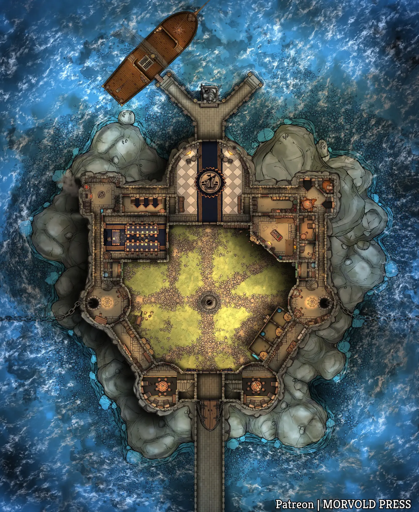
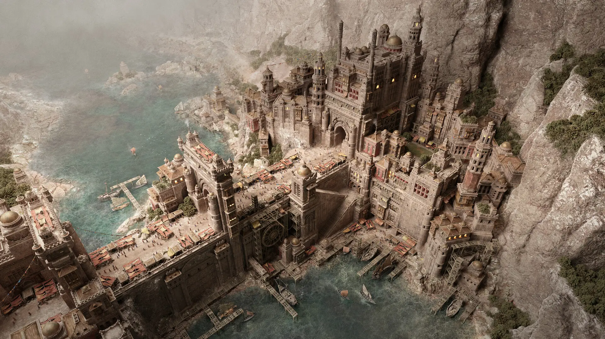
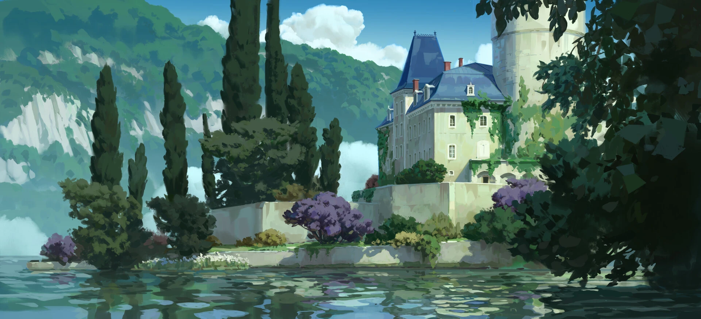
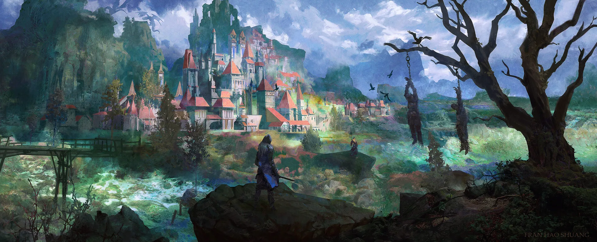
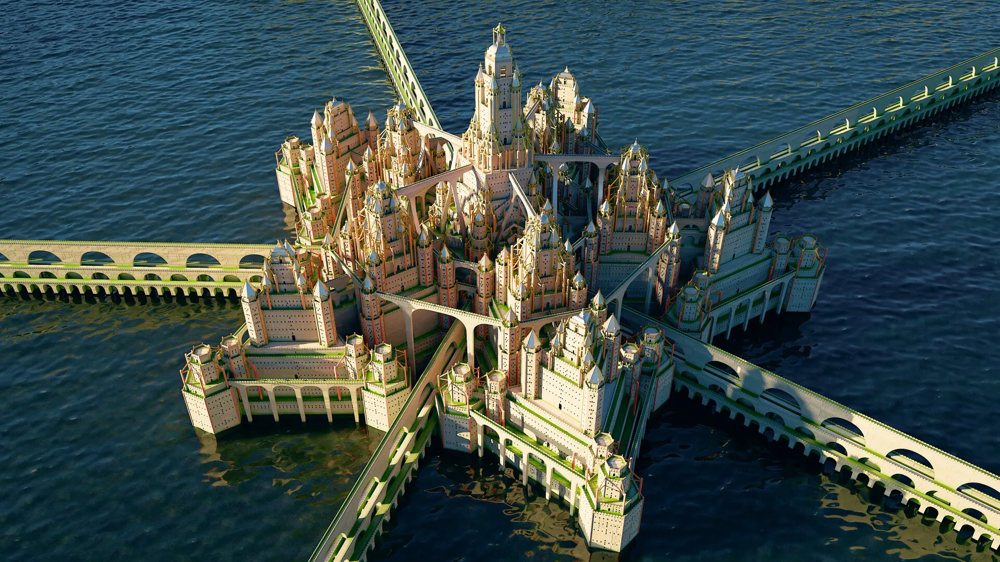
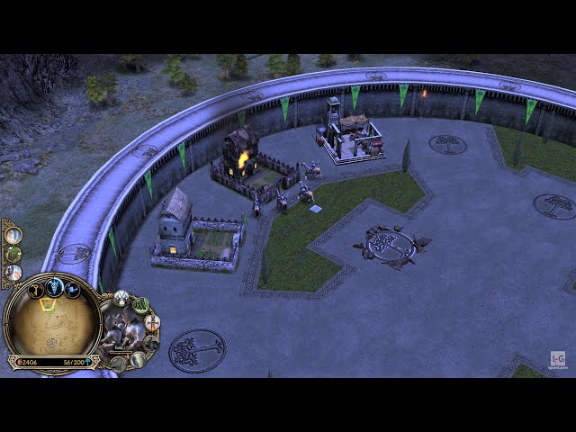
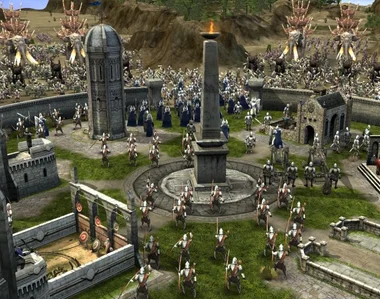
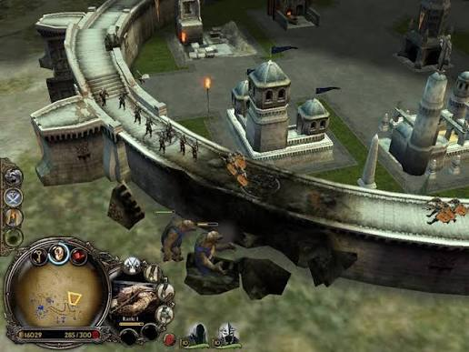

# Источник: восемь референсов замка (осада, оборона куста 3)

Добавлено 31.10.2026. Восемь картинок из постановки задачи «осада замка» ([../design-tower-defence.md](../design-tower-defence.md), раздел 9): пять артов замков и три скриншота *The Lord of the Rings: The Battle for Middle-earth* — механика стен. Замок в игре стоит **на лугу, не на острове**: картинки — только про вид замка и механику. Файлы — `castle-refs/`. Источник не правим.

| | |
|---|---|
|  |  |
| **1. Форт на острове** (карта сверху, Morvold Press). | **2. Город-крепость на скале.** |
|  |  |
| **3. Усадьба у озера** (Ghibli-стиль). | **4. Замок с красными крышами** (Fran Hao Shuang). |
|  |  |
| **5. Цитадель на воде.** | **6. BFME: кольцевая стена, площадки под постройки.** |
|  |  |
| **7. BFME: двор крепости.** | **8. BFME: пролом в стене.** |

## Что видно

**1. Форт на острове** — вид сверху: кольцо стен с круглыми башнями по углам, ворота с пристанью, внутри двор с колодцем в центре и постройки по периметру у стен, зубцы по наружной грани. **2, 5** — многоярусные крепости: стены с зубцами, башни-бастионы, мосты-дороги к воротам. **3** — светлый дом с синей крышей и круглой башней в зелени у воды: дневной свет, кипарисы, цветы. **4** — замок с красными крышами на скале над лугом, впереди болото и мостки.

**6–8 (BFME)** — механика, которую повторяем: круглая стена с **площадками для построек** внутри и на стене (6, 7), двор с постройками вокруг центра (7), **пролом в стене** от осадных орудий, через который бегут враги (8).

## Что берём

| Что | Куда |
|---|---|
| Квадрат стен с бастионами по углам, ворота между двумя башнями, двор с колодцем, площадки у стен (1, 6, 7) | карта `td3` — `src/level/td-castle-map.ts` |
| Зубцы по наружной грани, дорожка поверху, лестницы на стену (1, 2, 5) | стены из `bricks`, верх `tiles`, ступени `bricks_stairs` |
| Дневной свет, луг, рощи и цветы вокруг (3, 4) | `meta.world`, декор луга |
| Пролом в стене, враги бегут внутрь, стена чинится (8) | `src/td/wall.ts`, `TowerDefense.breach`, F — починка |
| Постройки на стене и внутри — башни на площадках (6, 7) | `TdPad.y`, бастионы |
