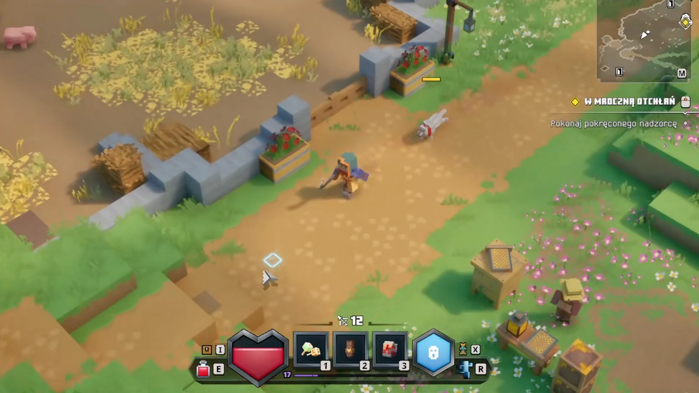
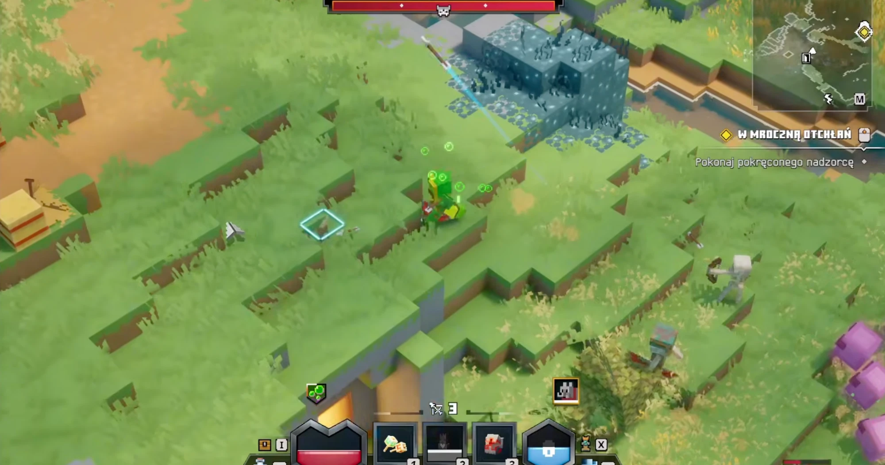
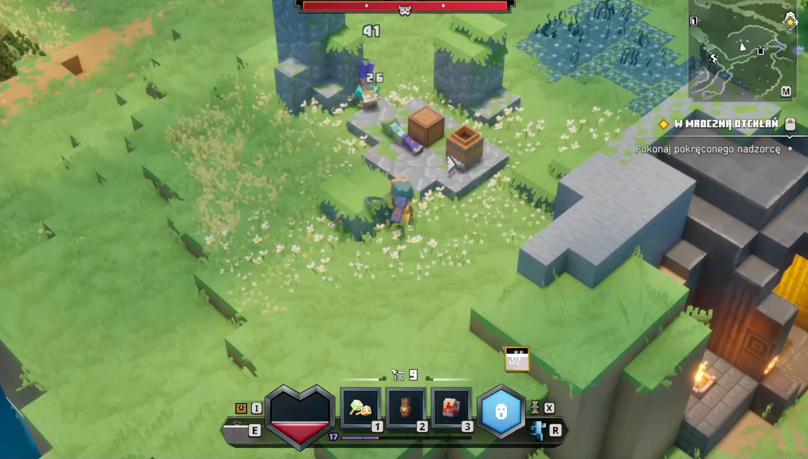
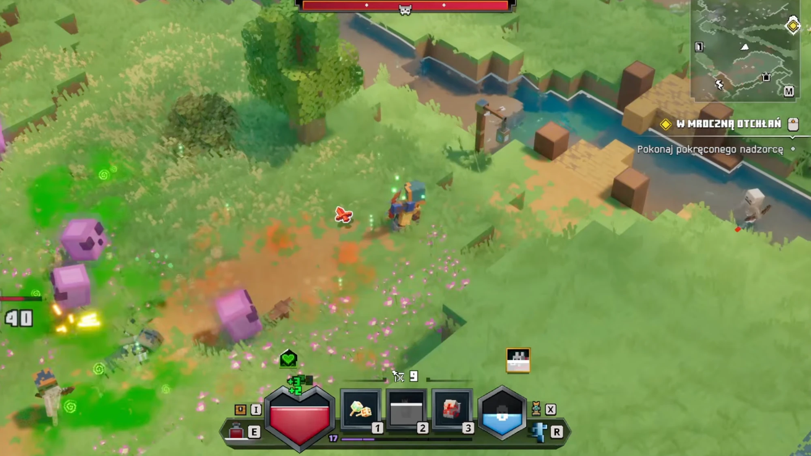

# Источник: свет и декор Minecraft Dungeons (4 скриншота)

Добавлено 23.10.2026. Скриншоты игры на Unreal Engine 4 (польская локализация, миссия «W mroczną otchłań»), камера — изометрия сверху под углом, день. Файлы — `mcd-lighting/`. Источник не правим; выводы — в [../style-lighting.md](../style-lighting.md) и [../design-level-decor.md](../design-level-decor.md).

| | |
|---|---|
|  |  |
| **1. Деревня у дороги.** | **2. Травяные уступы.** |
|  |  |
| **3. Руины с ящиками и факелом.** | **4. Река, дерево, причал.** |

## Что видно

**Свет**
- Солнце тёплое, светит низко и сбоку (сверху слева): тени длинные, мягкие по краю, падают вправо-вниз (1, 3).
- Тени не чёрные: в них голубовато-зелёный оттенок неба, детали в тени читаются (1, 2, 4).
- Затенение в щелях и у подножий: где стена встречает землю, под ящиками, под кромкой уступов (1, 3) — похоже на SSAO.
- Факел на тёмном камне даёт тёплое пятно и оранжевый отсвет на соседних блоках (3).
- Светлое (белые цветы, вода, пух шерсти) мягко светится — bloom (1, 4).

**Камера и «плёнка»**
- **Tilt-shift:** верх кадра и часто нижний край заметно размыты, резкая полоса — вокруг героя (1, 2, 4: свинья, поле, деревья вверху — в мыле). Это главный узнаваемый приём: мир похож на игрушечную диораму.
- Дымка: дальнее (верх кадра) светлее и чуть голубее, контраст ниже (2, 4).
- Цвет насыщенный, но мягкий: трава жёлто-зелёная, тени холоднее, освещённое теплее — раздельное тонирование. Чёрных и белых провалов нет (фильмический тонмаппинг).

**Декор — не блоки**
- Каменная ограда с рваным «лесенкой» верхом, деревянные пролёты забора между столбами, ящики с красными цветами, фонарь на изогнутом столбе (1, 4) — отдельные модели «из кубиков», стоят вне сетки.
- Стопки ящиков и сундук стоят чуть криво (3); горшок-урна, ящик — не по сетке.
- **Травяная бахрома:** по краю каждого уступа свисает зубчатая полоса травы (2, 3) — отдельная геометрия поверх блоков, ломает жёсткий край куба.
- Пятна цветов, высокая трава и пучки — плотной россыпью, мелкие, не по одному на клетку (1, 2).
- Голубой «мшистый» блок с лозами (2), причал из досок на столбах над водой (4), дерево с кроной из кубов листвы разного размера (4).

## Что берём

| Приём | Куда | Статус |
|---|---|---|
| Тёплое низкое солнце, голубые тени, ACES | `src/lighting.ts` | сделано 23.10.2026 |
| AO в щелях (GTAO без травы и листьев) | `src/lighting.ts` | сделано |
| Tilt-shift: размытие верха и низа, резкая полоса у героя | `src/lighting.ts` | сделано, затем убрано 23.10.2026 — дорого по кадрам |
| Дымка вдали, раздельное тонирование, +насыщенность | `src/lighting.ts` | сделано |
| Свободный декор: колонны, ограды, фонари, ящики с цветами, кривые ящики | `src/level/decor.ts` | сделано (16 предметов) |
| Травяная бахрома по краю уступов | мешер: `fringe` у травы, слой `detail` | сделано 23.10.2026 |
| Плотная россыпь мелкой травы и цветов | мешер: `tufts` у травы, пятнами по шуму | сделано 23.10.2026 |
