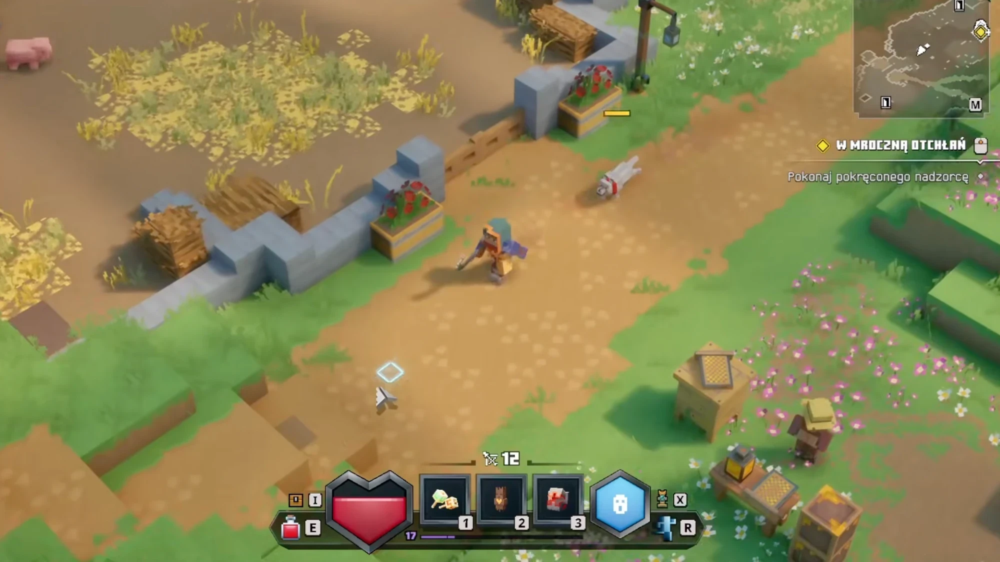
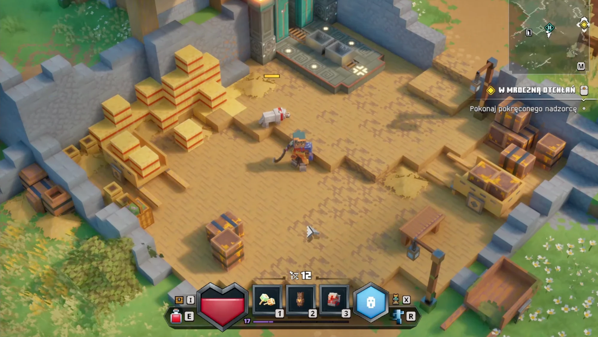
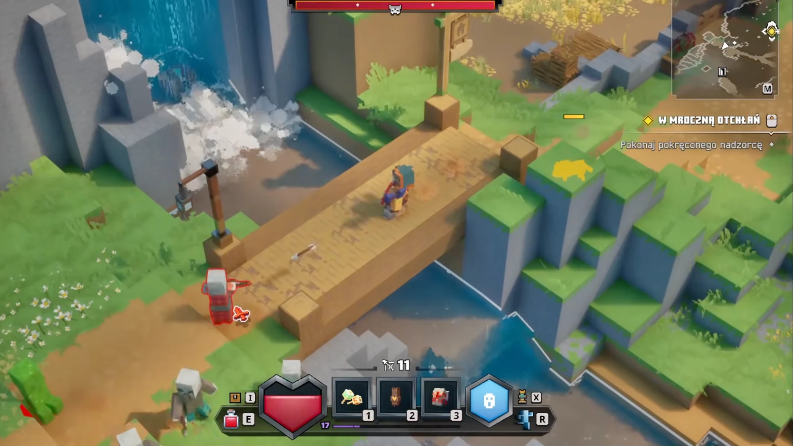
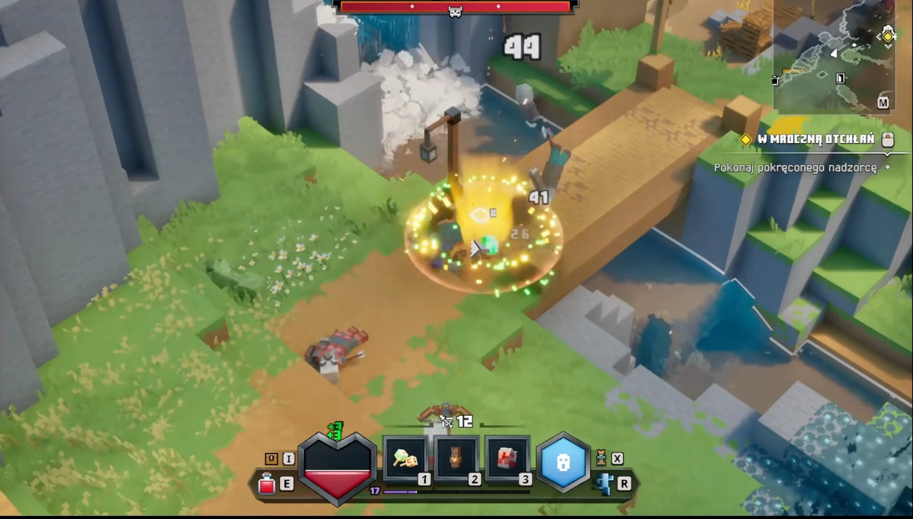
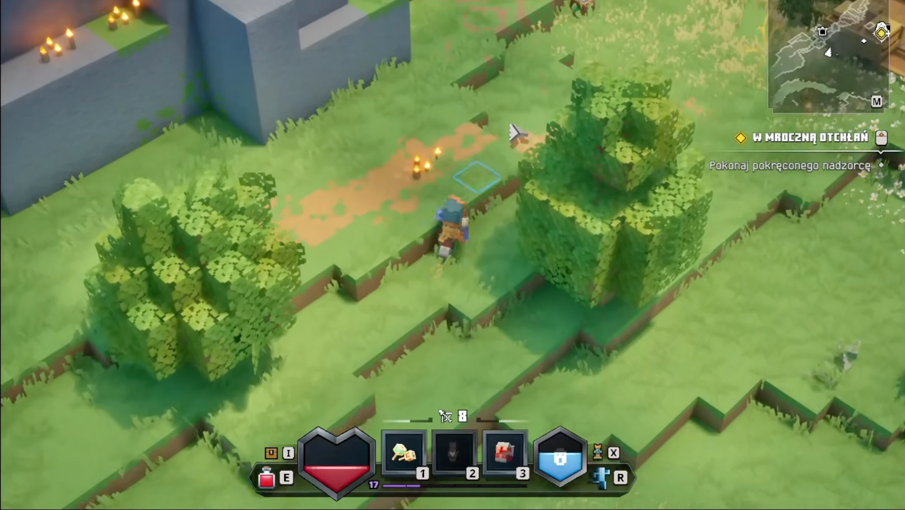
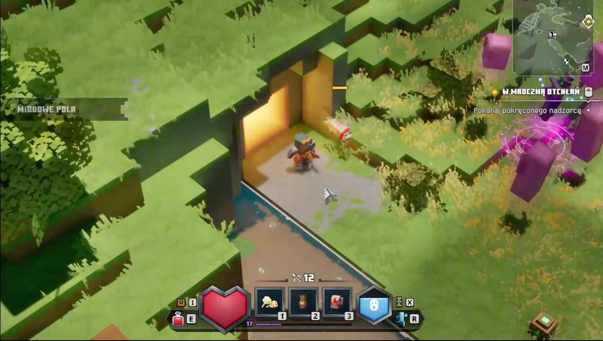
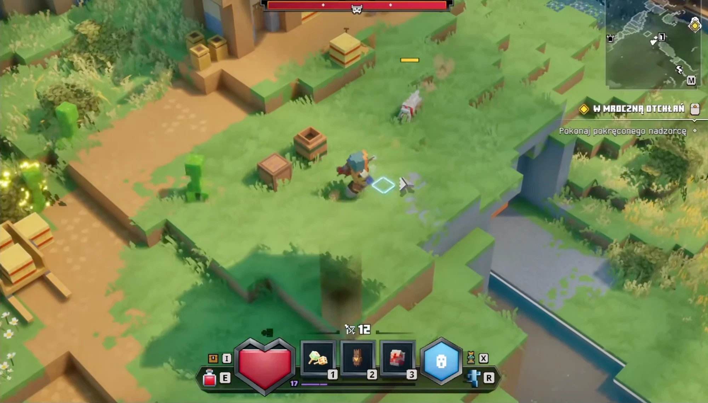

# Источник: мир Minecraft Dungeons — двор, река, скалы, холмы, портал (9 скриншотов)

Добавлено 24.10.2026. Скриншоты миссии «W mroczną otchłań» (Unreal Engine 4), камера сверху под углом, день. Файлы — `mcd-world/`. Источник не правим; выводы — в [../style-world.md](../style-world.md) (наборы блоков и сборок), дороги — в [../style-terrain.md](../style-terrain.md).

| | |
|---|---|
|  |  |
| **9. Дорога у деревни** — рваный край, следы. | **10. Двор со складом.** |
|  |  |
| **11. Водопад, река, мост.** | **12. Скалы по краю уровня.** |
|  |  |
| **13. Холмы террасами, деревья, свечи на стене.** | **14. Портал в холме.** |
|  |  |
| **15. Разнообразие холмов.** | **16. Холмы-плиты.** |
|  | |
| **17. Плато с обрывом из скалы.** | |

## Что видно

**10. Двор.** Пол — утоптанная земля `#c59b5c` с тёмными штрихами «ёлочкой» `#ae855e`, с уступами в полблока. Ограды — светлый голубовато-серый камень `#78787a`–`#83868e` со ступенчатым верхом (высота гуляет блоками). Стог из тюков сена `#d0af54` с оранжево-красными обвязками `#ba541c`. Ящики — тёмное дерево `#9f6e5a`, железные полосы, пятна жёлтой краски `#e4ad33`; сундуки, ящички, телега на двух колёсах `#9e6647`, скамья, фонари на изогнутых столбах `#a9844f`.

**11. Водопад и река.** Скала светло-серая, ровная, с вертикальными пластами; водопад — бирюзовые струи `#0f7592`, у подножия белые клубы брызг `#b2b3b0`–`#dbd5d0`. Река в русле на полтора блока ниже травы, тёмная бирюза `#44687a`, светлые полосы вдоль течения, белая кромка у берегов. Мост — толстый настил из светлых досок `#b68c58`–`#cea86c`, по углам квадратные столбы `#846438`. Справа — травяные столбы скал ступенями к воде.

**12. Края уровня.** Высокие скалы 5–8 блоков, свет `#70767a`, в тени синие `#425966`; трава сверху свисает бахромой; каменные ступени.

**13. Холмы и свечи.** Холм — террасы по 1 блоку с бахромой травы; деревья — кубы листвы `#598230` с пышными краями, блик `#99b956`. На крепостной стене стоят свечи — вокруг тёплое пятно, без видимого источника света (запечено).

**14. Портал.** Проём в холме, рама из тёмного камня, внутри золотое сияние `#e6b144` с ярким ядром `#fee99a`, стены проёма окрашены золотом; перед ним светлые плиты `#af9f8e`, на них заходит трава.

**16, 17. Холмы-плиты** (добавлены 24.10.2026). Холмы пологие и плоские: широкие плиты одна над другой с перепадом в 1 блок, края — длинные прямые и ступенчатые диагонали под 45°; на высоких перепадах под травой — голубоватая скала; на площадках стоят мобы, между уровнями — проходы.

**15. Холмы.** Уступы травы, ступени из земли тропинки, скальные стороны под травой, пятна сухой жёлто-зелёной травы `#b9b957`, белые ромашки.

## Что берём

| Приём | Куда | Статус |
|---|---|---|
| Пол двора, ступенчатые ограды, сено, ящики, сундук, телеги, скамья, 3 вида фонарей | палитра «двор», декор «склад», «фонари», сборки `steppedWall`, `hayStack` | сделано 24.10.2026 |
| Скалы (светлая, тёмная, с травой, ступени), водопад с бегущими струями, река с течением, мост, брызги и пена | палитра «скалы и вода», слои `falls` и `river`, декор «вода», сборки `cliffMass`, `cliffSteps`, `riverBed`, `waterfall`, `bridgeX`, `stairway` | сделано |
| Холмы террасами, полублок травы, пышная листва, свечи с запечённым светом | палитра «холмы», декор «свечи», атрибут `bake`, сборки `hill`, `tree`, `rampart` | сделано |
| Портал: сияние с анимацией, рама, перемычка, пол, золотой запечённый свет | палитра «портал», слой `portal`, сборка `portal` | сделано |
| Сухая трава, ромашки, ступени тропинки, холм с обрывом | палитра «холмы», опции `hill` | сделано |
