# Источник: холмистые земли с поселениями — Elden Ring и Minecraft Dungeons (17 скриншотов)

Добавлено 29.10.2026. Референсы для библиотеки готовых пресетов (`wiki/design-prefab-library.md`): открытые холмы, дороги, руины и небольшие поселения на пути. Файлы — `refs-settlements/`. Источник не правим; выводы — в [../design-prefab-library.md](../design-prefab-library.md). Elden Ring даёт **композицию и набор объектов**, Minecraft Dungeons — **масштаб, плотность мелочей и гамму** (стиль по-прежнему детский воксельный, [../style-guide.md](../style-guide.md)).

| | |
|---|---|
| 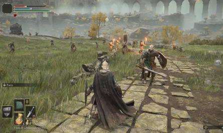 | 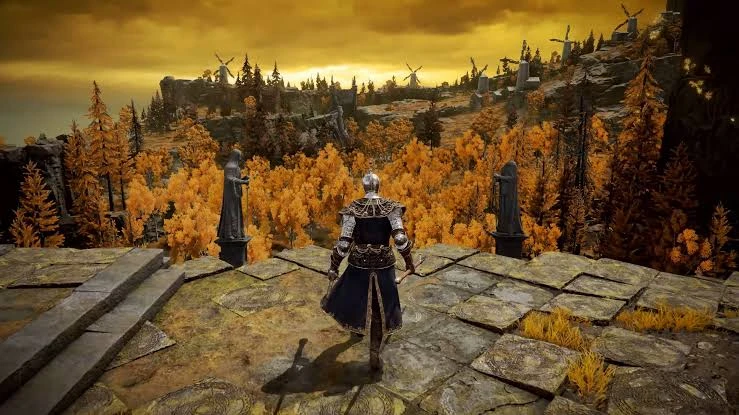 |
| **1. Лимгрейв: дорога из плит, лагерь солдат с кострами, акведук вдали.** | **2. Золотые лиственницы, каменная площадка со статуями, мельницы на горизонте.** |
| 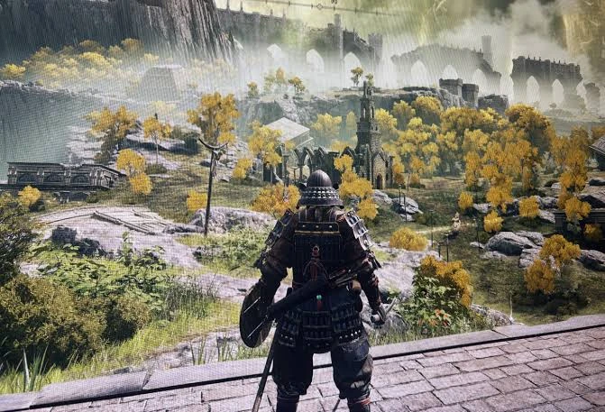 | 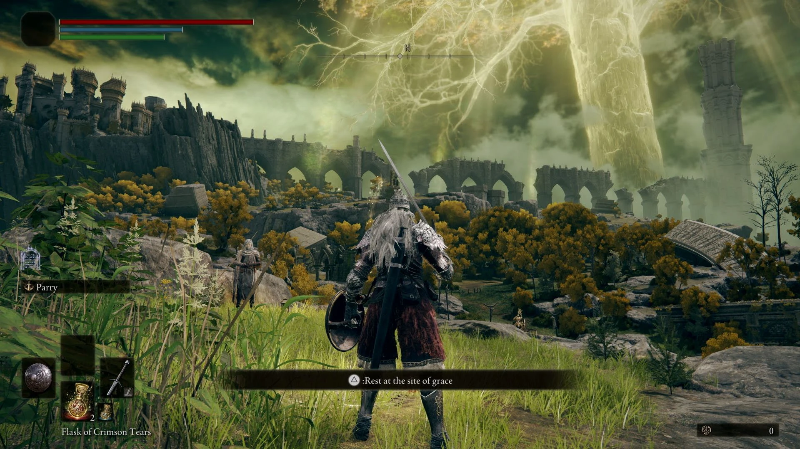 |
| **3. С обрыва на долину: капелла-руина, деревня, скалы.** | **4. Место благодати, ряд арок-руин, замок на скале.** |
| 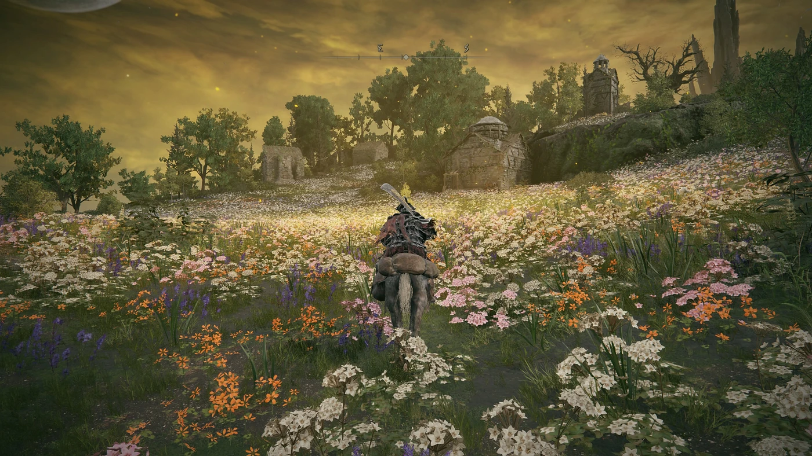 | 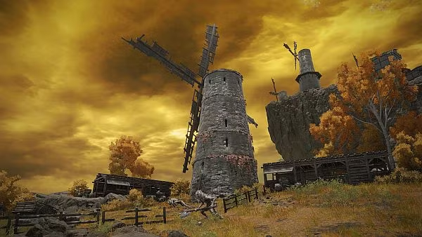 |
| **5. Луг в цветах, домик и башня на холме.** | **6. Мельница с крыльями, сараи, забор.** |
| 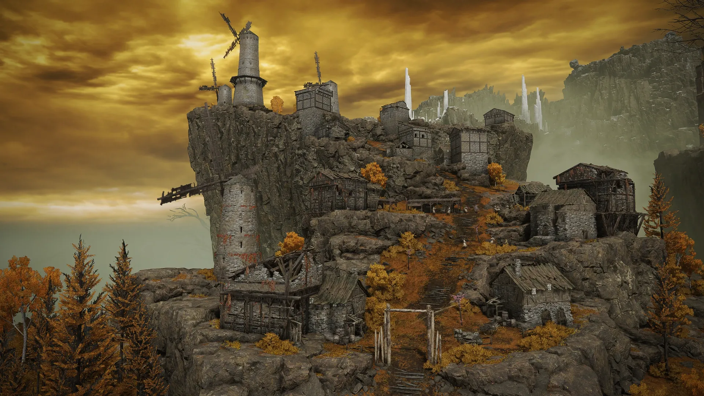 | 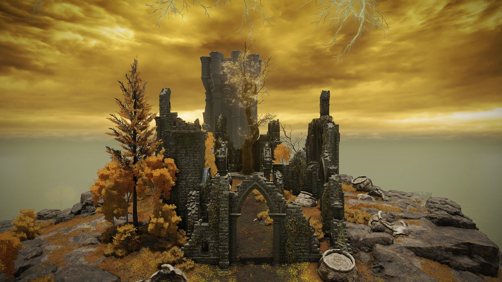 |
| **7. Деревня мельниц на скале: дома, лестницы, заборы.** | **8. Капелла-руина с деревом внутри, чаши, круглая башня.** |
| 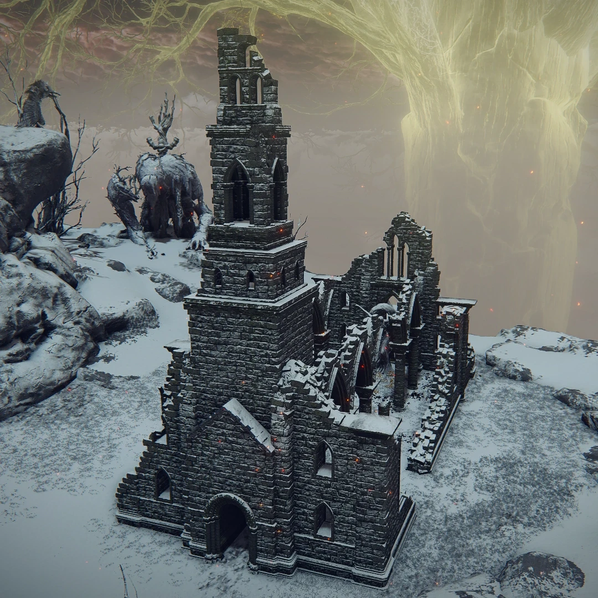 | 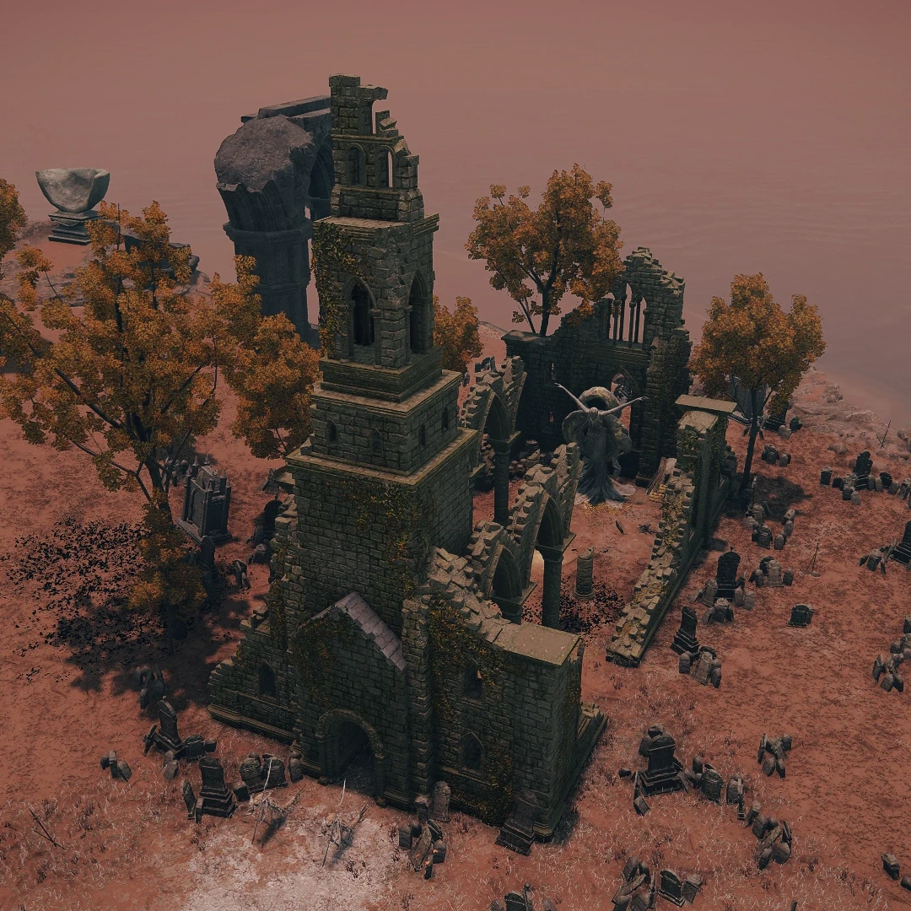 |
| **9. Церковь-руина с колокольней (снег).** | **10. Капелла среди надгробий (красная земля).** |
| 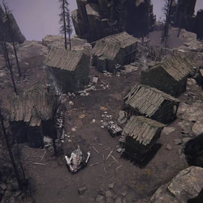 | 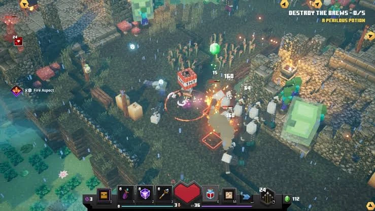 |
| **11. Посёлок соломенных хижин, тёмные ели.** | **12. MCD: грядки, бочки TNT, грибы, столбы.** |
| 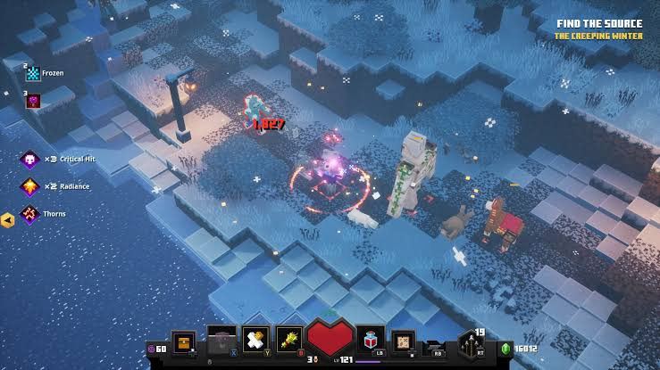 | 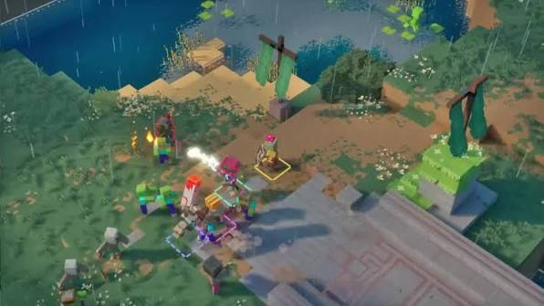 |
| **13. MCD: заснеженная долина (другой биом).** | **14. MCD: река, деревянный пирс, тростник.** |
| 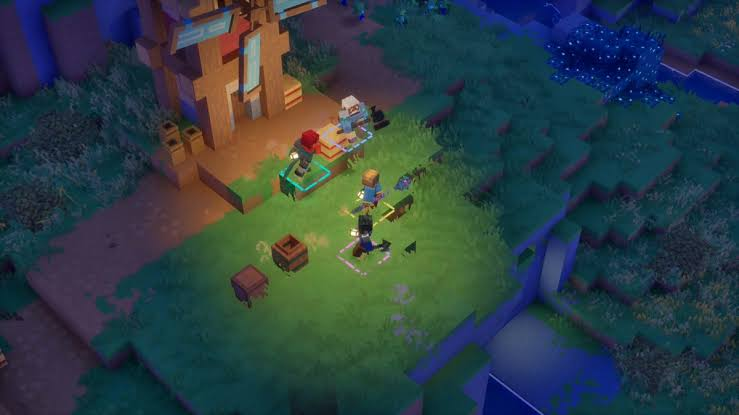 | 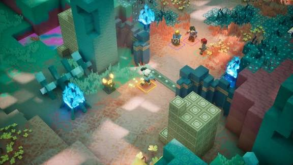 |
| **15. MCD: мельница ночью, фонари, бочки, ящики.** | **16. MCD: храм в джунглях, кристаллы (другой биом).** |
| 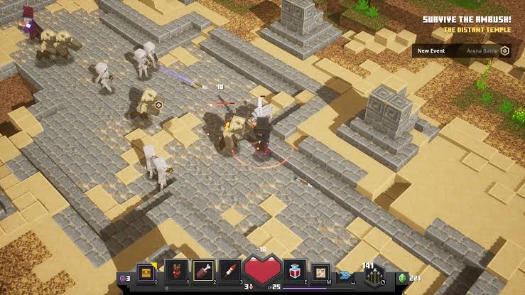 | |
| **17. MCD: пустынный храм, колонны, скелеты (другой биом).** | |

## Что видно

**1, 4. Дорога и руины Лимгрейва.** Дорога — крупные каменные плиты, часть выпала, в дырах трава и земля; край рваный, плиты уходят в траву. По бокам — голые деревья, валуны, обломки колонн. Лагерь: костры с котелками, палатки, брёвна-сиденья, знамёна на копьях, стойки с оружием. Руины — ряд арок одной высоты (акведук), часть пролётов обрушена, под ними щебень. «Место благодати» — золотое сияние на земле, вокруг травы нет.

**2. Площадка со статуями.** Каменная площадка из плит с лестницей вниз, по краям две статуи в капюшонах на постаментах. Золотые лиственницы — конусные кроны двух тонов (жёлтый и оранжевый), ствол тёмный. Вдали мельницы на холмах и надгробия.

**3, 7. Деревня на скале.** Мельницы — каменные круглые башни с решётчатыми крыльями из планок; крыльев четыре, одно часто сломано. Дома — каменный низ, деревянный верх, тёмная крыша, внешние лестницы и приставные лестницы, навесы. Заборы жердями, покосившиеся. Дорога — утоптанная оранжевая земля. На дворе козы, бочки, ящики, стога.

**5. Луг.** Ровная трава сплошь в цветах: белые, розовые, оранжевые, лиловые пятнами по 2–3 м. На холме каменный домик с полуразрушенной крышей и башенка. Деревья тёмно-зелёные, круглые.

**6, 15. Мельница с двором.** Мельница — башня в 8–9 блоков, крылья размахом с башню, у подножия навесы с соломой, сараи из тёмных досок, забор, колодец. Ночью: фонари на столбах, бочки, ящики, тыквы у стены (MCD).

**8, 9, 10. Капелла-руина.** Прямоугольный неф без крыши, колокольня в 2–3 яруса с арочными окнами, стены обломаны лесенкой, арки на половине высоты; внутри дерево или алтарь. Вокруг каменные чаши, горшки, щебень, кости, надгробия, плющ. На красной земле — кладбище: надгробия трёх форм, кресты, упавшие плиты.

**11. Соломенные хижины.** Низкие дома из брёвен с крышей из соломы шатром, костёр у входа, тёмные ели, земля серая.

**12, 14. MCD: деревня и пирс.** Грядки с ростками в бортиках, пугало, столбы с фонарями, бочки TNT, светящиеся грибы, тыквы. Река и деревянный пирс на столбах, тростник у берега, бочки на пирсе.

**13, 16, 17.** Другие биомы (снег, джунгли с кристаллами, пустыня с колоннами и скелетами) — на потом.

## Что берём

| Приём | Куда | Статус |
|---|---|---|
| Библиотека пресетов: формат в репозитории, генерация кодом, блоки + декор + свет, поворот на 90°, вкладка в редакторе, витрина `?map=prefabs` | `src/level/prefab-lib/`, `assets/prefabs/`, `scripts/gen-prefabs.ts`, [../design-prefab-library.md](../design-prefab-library.md) | сделано 29.10.2026 (партия 1: 4 пробных пресета; партия 5: 5 композиций из средних — деревня с мельницей, хутор, лагерь разбойников, руины у кладбища, обрыв со статуей) |
| Дороги из плит с выпавшими плитами, луга в цветах, пруд и ручей, золотые и голые деревья, ель, валуны | партия «Дорога и природа»: 20 строителей, блоки `leaves_gold`, `flower_orange`, `tiles_broken`, декор `tree_dead`, `reeds`, `stump`, `rock_small`, `leaf_litter` | сделано 29.10.2026 |
| Арки, акведук, капелла с колокольней, статуи, место благодати, кладбище, чаши | партия «Руины»: 11 строителей, руинный кирпич со ступенями и стенкой, декор — надгробия, крест, статуя, чаша, горшки, плющ, череп | сделано 29.10.2026 |
| Мельница с крыльями, дома, хижины, заборы, колодец, грядки, лагерь, пирс | партия «Поселение»: 17 строителей, блоки `crops`, солома и черепица, 14 предметов декора (бочки, мешки, колодец, лестница, палатка, пугало, дрова, указатель, сломанная телега) | сделано 29.10.2026 |
| Снег: снежная земля, лёд, сугробы, сосульки, снеговик, снежные варианты построек, зимний хутор | биом «снег», `builders-snow.ts`, земля на выбор в ландшафте | сделано 29.10.2026 |
| Джунгли с кристаллами, пустынный храм | биомы «джунгли», «пустыня» | план |
