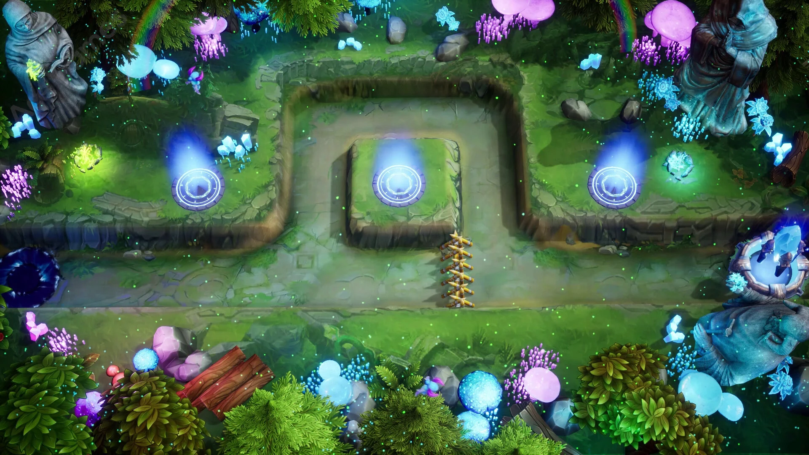
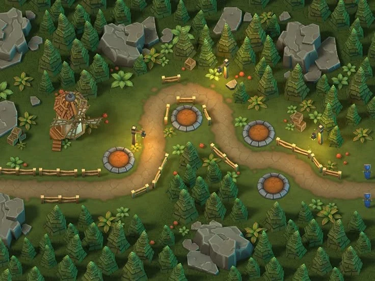
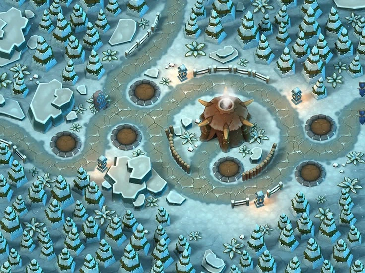
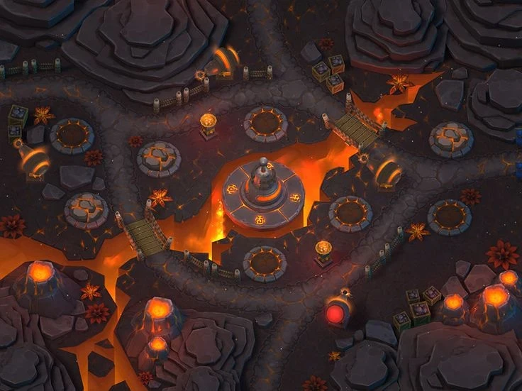

# Source: four tower defence maps (Bush Defence references)

Added 2026-10-31. Four screenshots of TD maps from the "Bush Defence" task brief ([../design-tower-defence.md](../design-tower-defence.md)): the lava map `td` and the Crystal Glade `td2` were made after them. Files — `td-refs/`. The source is not edited.

| | |
|---|---|
|  |  |
| **1. Crystal Glade** (night, Unreal style). | **2. Forest road** (cartoon isometric). |
|  |  |
| **3. Winter glade.** | **4. Lava basin.** |

## What is visible

**1. Crystal Glade** — night, a strictly top-down view. The enemies' road is a **trench with stone walls** one block below the grass: it enters from the left, goes around a square island in the centre in a U shape and leaves to the right; at the bottom there is one more straight road. Three blue **portal pads** (rings of light with a pillar of glow) — on the island and on two platforms at the sides; on the road — a barricade of stakes. Along the edges — **hooded statues** (grey stone), pink and blue **lamp mushrooms** with droplet-shaped stalks, **blue crystals** in clusters, ferns, spruces and bushes, a rainbow in the corners, at the bottom left a dark **whirlpool portal** (the enemy entrance), at the right a blue **ring portal**. Green **fireflies** everywhere; the light is cold blue-green, only the mushrooms, crystals and portals glow.

**2. Forest road** — day, warm isometric: a dirt path winds in an S between spruces, **round stone pads with sand** for towers on both sides, **small fences** along the path, lanterns on posts, a windmill, boulders with flat tops, exit points (blue flags) on the right.

**3. Winter glade** — snow and ice: in the centre a **spiky core** (what we defend) on a round pad, a ring road around it, tower pads in a circle, ice floes with blue faces, spruces under snow, small fences, blue entrance flags.

**4. Lava basin** — dark stone, **rifts with lava** glowing from below, bridges with railings, braziers and lanterns, volcanoes with craters in the corners, loot cages by the entrances, a central altar on an island in the lava. The most atmospheric: the light and haze above the rifts.

## What we take

| Technique | Where | Status |
|---|---|---|
| Trench road with stone walls, an island in the centre, portals, lamp mushrooms, crystals, statues, fireflies, a cold night (1) | the `td2` map "Crystal Glade" | done 2026-10-31 |
| Round pads with a rim, small fences along the roads, lanterns at the turns (2) | pads and roads of both maps | done |
| A core in the centre with a ring road, pads in a circle (3) | the bush in the centre, roads converge on it | done |
| Lava in rifts, bridges, volcanoes, braziers, cages by the lairs, haze (4) | the `td` map | done 2026-10-31 |
