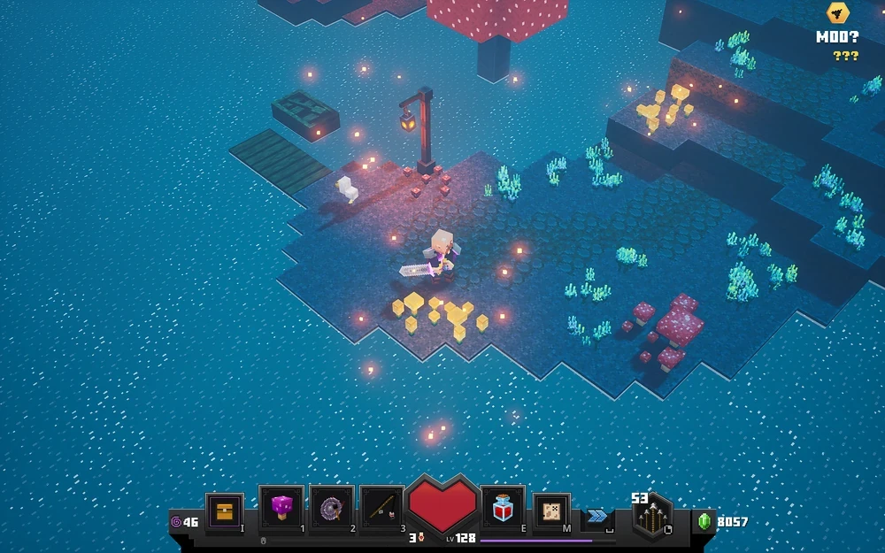
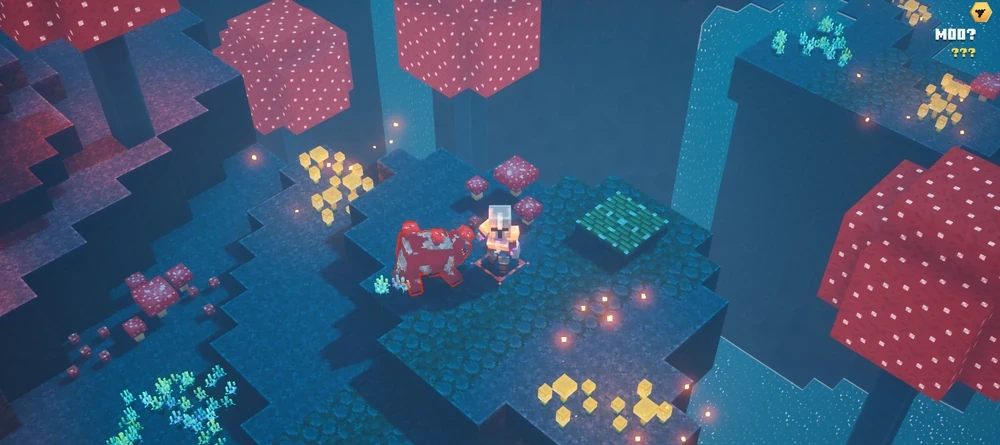
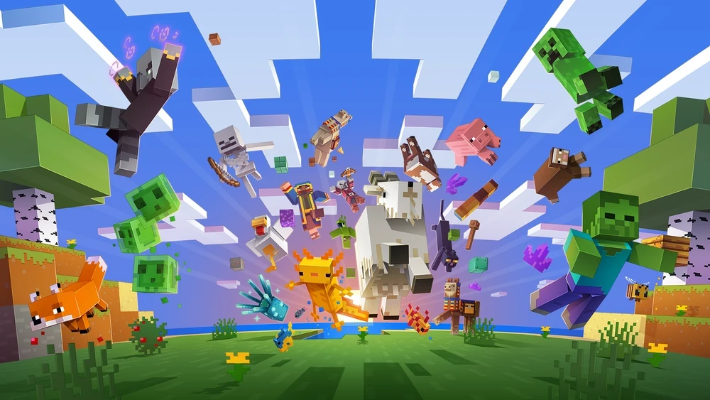
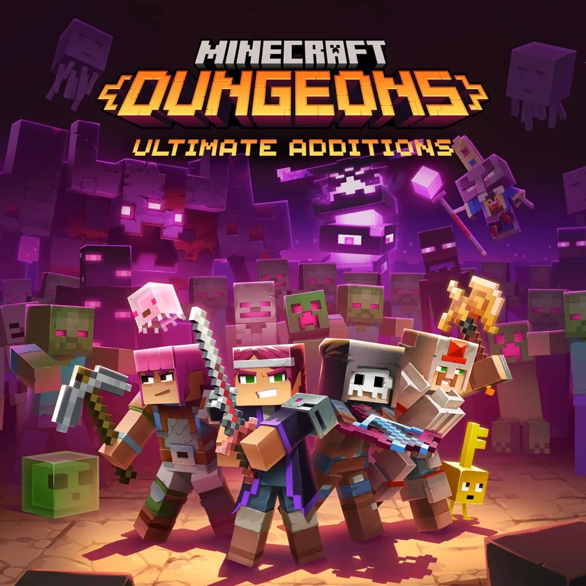
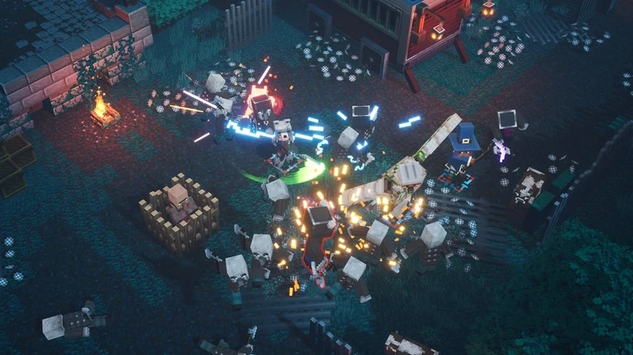
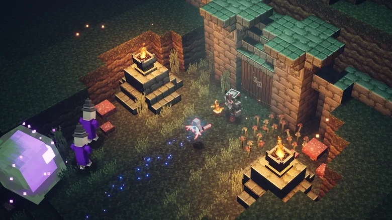
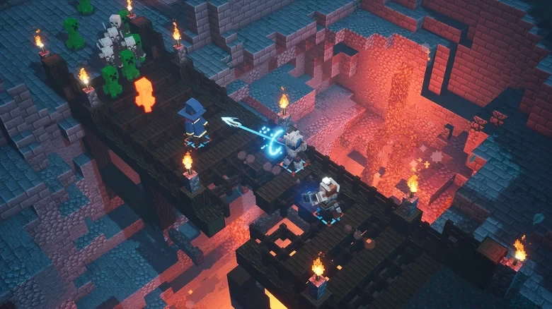
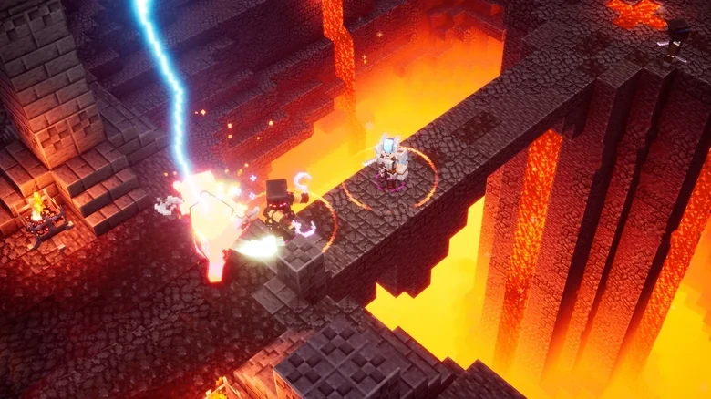
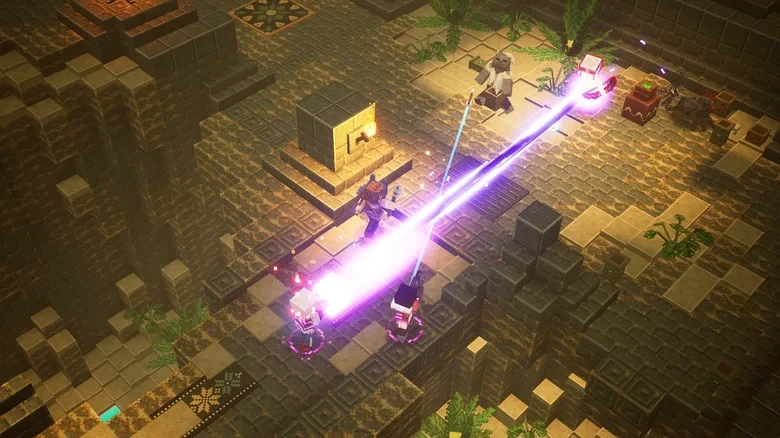

# The style of Malina: a friendly voxel world in the spirit of Minecraft Dungeons

The decision — `adr-004-mystic-coop-melee.md`. Here — the references and the rules by which we check any new scene, model or effect.

**In short:** a bright, friendly, slightly magical world of little cubes. Childlike toy-likeness, not realism. A dark dungeon is still cosy — it is lit by warm fires, fireflies and coloured magic.

## References

| | |
|---|---|
|  |  |
| **1. Mushroom island.** A turquoise-blue palette, water with running glints, glowing yellow mushrooms, a lantern, orange fireflies. HUD — a large heart and slots. | **2. Giant mushrooms.** Red caps with white polka dots, waterfalls, golden flowers glow, soft shadows. |
|  |  |
| **3. Minecraft.** Sky, cubic clouds, animals and mobs — simple shapes, large colour patches, a good mood. | **4. Minecraft Dungeons heroes.** Sword, pickaxe, axe; big heads, short arms, smiles. Enemies — with bright eyes, but not scary. |
|  |  |
| **5. Night battle.** A dark blue background, warm torches, the blade leaves bright glowing arcs, sparks, lightning. | **6. Night field.** Stone braziers with fire, a violet crystal, blue fireflies, ruins with a turquoise roof. |
|  |  |
| **7. Fiery dungeon.** A bridge of dark wood over an orange chasm, torches, the magic trail of an arrow. | **8. The Nether.** Lavafalls, a stone bridge, lightning — hot, but bright and cartoonish. |
|  | |
| **9. Desert temple.** Sandstone, patterned tiles, a violet beam of magic, ferns. | |

## Rules

### Shapes and characters
- Everything is made of cubes and rectangular parts. Detail — through colour and pixel texture, not geometry.
- **Toy proportions:** a large head (≈ the width of the shoulders), short arms and legs, the body — a little brick. Animation — rotations of whole parts, like a marionette.
- A character reads by silhouette from above at an angle: bright clothes, a contrasting cloak or hood, the weapon larger than "real".
- Enemies are not scary but funny: glowing eyes, a clear "bad" colour, no blood — on damage, blocky shards and coloured sparks.

### Colour and light
- **A saturated palette.** Day — warm grass, blue sky, white cubic clouds. Night and dungeons — a turquoise-blue base.
- **Contrast of warm and cold:** blue shadows and stone against orange torches, yellow mushrooms and pink-red accents (raspberries!).
- **Glowing accents** (bloom): fire, crystals, mushrooms, magic, enemy eyes, the blade trail. Few things glow — then it is noticeable.
- Shadows are soft, without black pits; grey fog and "dirty" filters are not used. A light bright haze in the distance and tilt-shift — yes: this is Unreal-style lighting, details — [style-lighting.md](style-lighting.md).

### Water, fire, atmosphere
- **Water is alive:** the surface sways slowly, white glints run across it, light foam at the shores. Colour — turquoise or a bright blue.
- Fire — frame-animated, pixel, with a warm point light and sparks.
- In the air — fireflies, pollen, sparks: small glowing squares drift slowly.

### Combat and effects
- A sword strike leaves a **glowing arc trail**; the combo builds up: the finisher is brighter, wider and with a shock wave on the ground.
- A hit — a short pause (hit-stop), a flash of the target, a floating damage number, spark cubes.
- Magic — coloured beams and rings (violet, turquoise, gold).

### Interface
- Large and friendly: the health heart in the centre, square slots with a thick outline, pixel icons, a sans-serif font with rounded shapes.
- Left of the heart — three spell slots (1 / 2 / 3) and the weapon, right — the dodge roll and raspberries. Cooldown — a dark fill of the slot from top to bottom.
- The cursor — a white diamond; over a target it reddens and enlarges, with Shift — yellow. A click on the ground leaves a melting ring.

## What we do not do
- Realism: photo materials, realistic proportions, firearms, military uniforms.
- Blood, dismemberment, "adult" horror.
- Grey utility scenes as the main view — even the playground looks like a piece of the game world.
- Film effects: grain, chromatic aberration, a strong vignette.
